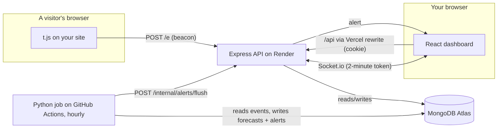

# Footfall

Footfall is web analytics for small websites. You add one line to your site, and Footfall shows who visits, which pages they read, where they came from and where they give up. It also learns each site's normal traffic and tells you when something unusual happens. It does all of this without cookies and without storing anyone's IP address.

- Dashboard: https://footfall-sigma.vercel.app
- Source: https://github.com/shwetankg07/footfall

The API runs on Render's free tier. A scheduled ping keeps it awake, but if it was asleep the first request can take up to a minute.

## Problem

If you run a portfolio, a side project or a small shop, you want to know whether anyone visits and what they do. Today the choice is Google Analytics or nothing. Google Analytics is heavy, sets cookies (so you need a consent banner), sends your visitors' data to Google, and buries the few numbers you care about under hundreds of reports. It also only tells you something is wrong if you happen to look. If your traffic doubles because someone shared your project on LinkedIn, or drops to zero because a deploy broke the site, you find out days later, if ever.

## Who it's for

Students, indie developers and small teams with one or a few websites, a few to a few thousand visits a day, and no time to set up an analytics stack. Most of them get a handful of visits an hour, which is exactly the range where "is this normal?" is hard to answer by eye.

## Solution

A one-line script sends a tiny beacon for each page view. The server turns the visitor into an anonymous code that changes every day, stores the event, and pushes the live visitor count to anyone watching the dashboard. The dashboard answers the questions people actually ask: how many people came, from where, on what device, which pages, and how many made it through the steps that matter (a funnel). Every hour, a Python job learns each site's weekly rhythm and predicts a normal range for the next 24 hours. When an hour lands far outside that range, everyone on the site gets an alert.

## Key features

These are the five workflows, each working end to end:

1. **Add a site.** Sign up, add your domain, paste the snippet. The dashboard waits for the first visit and switches over by itself the moment it arrives.
2. **See your traffic.** Unique visitors, page views, views per visitor and bounce rate for the last 24 hours, 7, 30 or 90 days, each compared with the period before. Charts per hour or per day in the site's timezone, top pages, sources, devices, browsers, countries and custom events, plus a live count of who is on the site right now.
3. **Funnels.** Define 2 to 6 steps (pages, page prefixes like `/product/*`, or custom events like `paid`). Footfall counts visitors who complete the steps in order and shows where they drop off.
4. **Teams and sharing.** Invite teammates as admins or viewers with single-use invite links, change roles, remove people, or leave a site. Turn on a public read-only dashboard link, replace it, or turn it off.
5. **Forecasts and alerts.** An hourly ML job forecasts the normal range of page views for each site and flags spikes and drops. Alerts appear instantly in the dashboard (bell, toast and on the chart) and can also be emailed.

## Tech stack

| Part | What | Why |
|---|---|---|
| Tracker | Plain JavaScript, under 2 KB | Runs on any site, no dependencies, `sendBeacon` so it never slows a page down |
| API | Node 22, Express 5, Mongoose | Express 5 forwards async errors on its own, so controllers stay short |
| Database | MongoDB Atlas | Every chart and funnel is an aggregation pipeline over raw events |
| Live updates | Socket.io | Live visitor count, "installed" signal, alert notifications |
| Dashboard | React 19, Vite, Redux Toolkit, React Router | Redux holds what several screens share (login, sites, alerts, toasts) |
| Charts | Hand-written SVG | Full control over the forecast band, hover crosshair, keyboard reading and table view |
| ML | Python 3.12, pandas, statsmodels, scipy, scikit-learn | The usual tools for time series and evaluation |
| Hosting | Vercel (dashboard), Render (API), Atlas (database), GitHub Actions (ML job and keep-awake ping) | All free tiers |

## Architecture



**Collecting a page view.** `t.js` sends `{domain, event name, url, referrer}` as a text beacon to `POST /e`. The server:
- rejects bots, unknown domains, and events whose `Origin` and page URL are not on the site's domain;
- rate-limits by IP;
- hashes `daily salt + site + IP + user agent` into the visitor id;
- stores one event document;
- updates the in-memory live count and pushes it to the site's socket room.

The salt is random per day and deleted after two days, so a visitor can't be linked across days and the IP is never stored.

**Reading stats.** Every number on the dashboard comes from one `$facet` aggregation over the raw events for a site and date range. That one pipeline produces the summary, the time series (bucketed with `$dateTrunc` in the site's timezone), and every breakdown. A second small pipeline gives the previous period for comparison. Empty buckets are filled in so charts never skip hours, and the bucket boundaries are DST-safe (`server/utils/timeBuckets.check.js`).

**Funnels.** The aggregation pulls only the events that could match a step, grouped per visitor in time order. A small pure function then walks each visitor's events and counts how far they got (`server/utils/funnel.js`, checked by `funnel.check.js`).

**The ML job** (`ml/`) runs hourly on GitHub Actions. For each site with at least a week of history it:
- reads hourly page-view counts in the site's local hours;
- checks the last three completed hours against the forecast made before them;
- writes the next 24 hours of forecasts.

New alerts go into the `alerts` collection. Then the job calls the API, which sends them to everyone on the site over the socket and by email. If the job fails, the website keeps working and shows the last forecast.

**Data model.** `users`; `sites` (owner, members with roles, share token, timezone); `events` (one per page view or custom event, indexed by site and time); `funnels`; `invites` (hashed single-use tokens); `forecasts` and `alerts` (written by the ML job); `salts` (expire after two days).

### The ML part

Most sites get only a few visits an hour, and that changes the problem. A jump from 2 to 6 is noise. A jump from 11 to 38 is real. A plain z-score cries wolf all day. So the models treat visits as counts:
- the normal range is a 99% negative-binomial prediction interval;
- an alert needs both a tiny tail probability and an absolute change of at least 8 views;
- a drop is only judged when enough traffic was expected for a drop to mean something.

Four methods were compared in a walk-forward backtest on synthetic traffic at three traffic levels, with known spikes and outages injected:

| Method | MASE | Precision | Recall | F1 | False alerts |
|---|---:|---:|---:|---:|---:|
| Simple rule (2× / 0.5× of the weekly mean) | 1.381 | 0.070 | 0.722 | 0.127 | 696 |
| Same hour last week | 1.284 | 0.341 | 0.611 | 0.438 | 85 |
| **Seasonal profile (in production)** | **0.969** | **0.904** | 0.653 | **0.758** | **5** |
| Gradient boosting, Poisson loss | 1.046 | 0.472 | 0.708 | 0.567 | 57 |

The seasonal profile is a smoothed hour-of-week profile with recency weighting and a level adjustment. It won on both forecast error and F1. Boosting caught slightly more anomalies but raised 57 false alarms to its 5. The full method, the per-traffic-level results and the limits of a synthetic benchmark are in [`ml/README.md`](ml/README.md) and [`ml/reports/backtest.md`](ml/reports/backtest.md).

### Security decisions

- Passwords are hashed with bcrypt. The login JWT lives in an httpOnly cookie.
- The dashboard calls `/api` on its own origin: the Vite proxy in development, a Vercel rewrite in production. That keeps the cookie first-party with `SameSite=Lax`, so Safari keeps the login, and a form on another site can't send a request carrying the cookie.
- Sockets connect to the API directly and log in with a 2-minute token from `GET /api/auth/socket-token`, never with the cookie. Another website can't open a socket on a user's behalf.
- Every site route checks the caller's role (owner, admin or viewer) in one middleware. A site you can't see answers 404, not 403, so ids can't be probed.
- Invites are single-use links that expire after 7 days, and only a hash of the token is stored. Sign-up doesn't verify email addresses, so matching invites by email would let anyone claim one.
- Share links are random tokens that can be replaced or turned off. When access changes, every open socket watching that site has to prove access again.
- Login and sign-up are rate-limited per email address, and the tracker endpoint per IP. Request bodies are size-limited, and inputs are type-checked before they reach Mongoose.
- The ML job authenticates to the API with a shared secret, compared in constant time.

Known limits:
- Like Plausible, Footfall doesn't verify that you own a domain before you add it.
- The live visitor count is kept in memory, which assumes a single API instance.

## Local setup

You need Node 22+, Python 3.12 with [uv](https://docs.astral.sh/uv/) (only for the ML part), and a MongoDB. A local `mongod` works, and so does a free Atlas cluster.

```bash
git clone https://github.com/shwetankg07/footfall.git
cd footfall

# API on :8080
cd server
npm install
cp .env.example .env        # fill in JWT_SECRET and INTERNAL_SECRET (any long random strings)
npm run dev

# Dashboard on :5173 (second terminal)
cd client
npm install
cp .env.example .env
npm run dev
```

Open http://localhost:5173, create an account and add a site. To send real page views from a local page, add `data-dev` to the snippet (the tracker ignores localhost otherwise):

```html
<script defer src="http://localhost:8080/t.js" data-site="localhost" data-dev></script>
```

The ML part, with demo data for a site you created:

```bash
cd ml
uv venv --python 3.12 .venv && uv pip install -r requirements.txt
export MONGO_URI=mongodb://127.0.0.1:27017 MONGO_DB=footfall API_URL=http://localhost:8080 INTERNAL_SECRET=<same as server>
.venv/bin/python -m footfall_ml.seed_demo --site <site id> --days 28 --replace
.venv/bin/python -m footfall_ml.score --site <site id> --backfill-days 21
```

### Tests

- `cd server && npm test` starts the real API against an in-memory MongoDB and walks every workflow: sign-up, sites and roles, collection (including bots, forged origins and IP privacy), stats, funnels, invite links, share links, sockets, forecasts, alerts and deletion.
- `node utils/funnel.check.js` and `node utils/timeBuckets.check.js` check the funnel order rules and the DST-safe buckets.
- `cd ml && .venv/bin/python -m pytest` runs 45 tests on the generator, models, detector, backtest, data layer, scorer and seeder.

## Environment variables

**Server** (`server/.env`, see `server/.env.example`):

| Name | Required | What it's for |
|---|---|---|
| `MONGO_URI` | yes | MongoDB connection string |
| `MONGO_DB` | no | Database name, default `footfall`. Set explicitly because a URI without a database silently means `test`. |
| `JWT_SECRET` | yes | Signs login cookies and socket tokens |
| `CLIENT_URL` | yes | Dashboard origin(s) allowed to open sockets, comma-separated, no trailing slash |
| `INTERNAL_SECRET` | yes | Shared with the ML job for `POST /internal/alerts/flush` |
| `RESEND_API_KEY` | no | Alert emails through Resend; without it, alerts only show in the dashboard |
| `ALERT_FROM_EMAIL` | no | Sender for alert emails |
| `NODE_ENV` | prod | `production` turns on `Secure` cookies |
| `PORT` | no | Default 8080 |

**Dashboard** (`client/.env`): `VITE_API_URL` is the API's own address, used for the socket and the tracker snippet. `VITE_DEMO_SHARE_PATH` (optional) is a `/share/<token>` path shown as "See a live demo" on the home page. Vite bakes these in at build time, so redeploy after changing them.

**ML job** (GitHub Actions): secrets `MONGO_URI` and `INTERNAL_SECRET`, repository variable `API_URL`, optional variable `MONGO_DB`.

## Deployment

- **API on Render.** `render.yaml` is a blueprint: New → Blueprint → this repo. It builds `server/` with `npm ci --omit=dev`, checks `/health`, and generates `JWT_SECRET`. You fill in `MONGO_URI`, `INTERNAL_SECRET` and `CLIENT_URL` (the Vercel address).
- **Dashboard on Vercel.** Root directory `client`, with `VITE_API_URL` set to the Render address. `client/vercel.json` rewrites `/api/*` to the Render API (so cookies stay first-party) and every other path to `index.html`.
- **Database on MongoDB Atlas.** Free M0 cluster. Network access must allow Render and GitHub Actions (both use changing IPs).
- **ML job and keep-awake ping on GitHub Actions.** `.github/workflows/ml-score.yml` runs at :35 every hour, just after an IST hour closes. `keep-awake.yml` pings `/health` every 10 minutes so page views aren't lost while Render wakes up. Both need the secrets and variables listed above.

## API

Routes marked *auth* need the login cookie. *viewer*, *admin* and *owner* are the minimum role on that site.

| Method | Endpoint | Access |
|---|---|---|
| GET | `/t.js` | public |
| POST | `/e` | public (tracker) |
| POST | `/api/auth/register`, `/api/auth/login`, `/api/auth/logout` | public |
| GET | `/api/auth/me`, `/api/auth/socket-token` | auth |
| GET, POST | `/api/sites` | auth |
| GET | `/api/sites/:id` | viewer |
| PATCH | `/api/sites/:id` | admin |
| DELETE | `/api/sites/:id` | owner |
| GET | `/api/sites/:id/stats?from&to&unit` | viewer |
| GET | `/api/sites/:id/forecast?from&to` | viewer |
| GET | `/api/sites/:id/funnels`, `/api/sites/:id/funnels/:funnelId?from&to` | viewer |
| POST, DELETE | `/api/sites/:id/funnels`, `/api/sites/:id/funnels/:funnelId` | admin |
| GET | `/api/sites/:id/members` | viewer |
| PATCH | `/api/sites/:id/members/:userId` | admin |
| DELETE | `/api/sites/:id/members/:userId` | admin, or yourself to leave |
| POST, DELETE | `/api/sites/:id/invites`, `/api/sites/:id/invites/:inviteId` | admin |
| GET | `/api/invites/:token` | auth |
| POST | `/api/invites/:token/accept`, `/api/invites/:token/decline` | auth |
| POST, DELETE | `/api/sites/:id/share` | admin |
| GET | `/api/share/:token`, `/api/share/:token/stats` | public |
| GET | `/api/alerts?site` | auth |
| POST | `/api/alerts/:id/read`, `/api/alerts/read-all` | auth |
| POST | `/internal/alerts/flush` | ML job secret |
| GET | `/health` | public |
