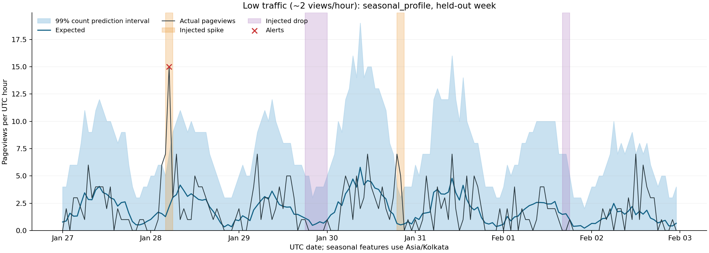

# Footfall walk-forward backtest

Production selection: **seasonal_profile**, selected by macro event F1 across low, medium and high traffic; lower MASE breaks a tie. Lowest aggregate MASE: **seasonal_profile**. Choosing the detector and choosing the smallest point error need not produce the same winner.

| Scenario / method | MAE | MASE | Precision | Recall | F1 | Normal coverage | False alerts |
|---|---:|---:|---:|---:|---:|---:|---:|
| naive_threshold | 55.62 | 1.381 | 0.070 | 0.722 | 0.127 | 99.7% | 696 |
| seasonal_naive | 47.84 | 1.284 | 0.341 | 0.611 | 0.438 | 93.3% | 85 |
| seasonal_profile | 36.21 | 0.969 | 0.904 | 0.653 | 0.758 | 99.8% | 5 |
| poisson_boosting | 40.01 | 1.046 | 0.472 | 0.708 | 0.567 | 97.6% | 57 |

## By traffic level

| Scenario / method | MAE | MASE | Precision | Recall | F1 | Normal coverage | False alerts |
|---|---:|---:|---:|---:|---:|---:|---:|
| low / naive_threshold | 1.83 | 1.035 | 0.889 | 0.333 | 0.485 | 99.9% | 1 |
| low / seasonal_naive | 1.99 | 1.127 | 1.000 | 0.292 | 0.452 | 90.4% | 0 |
| low / seasonal_profile | 1.51 | 0.855 | 1.000 | 0.333 | 0.500 | 100.0% | 0 |
| low / poisson_boosting | 1.58 | 0.894 | 0.889 | 0.333 | 0.485 | 98.8% | 1 |
| medium / naive_threshold | 14.56 | 1.414 | 0.059 | 0.917 | 0.111 | 100.0% | 352 |
| medium / seasonal_naive | 13.10 | 1.274 | 0.291 | 0.667 | 0.405 | 94.4% | 39 |
| medium / seasonal_profile | 9.69 | 0.945 | 0.947 | 0.750 | 0.837 | 99.9% | 1 |
| medium / poisson_boosting | 10.47 | 1.020 | 0.444 | 0.833 | 0.580 | 97.3% | 25 |
| high / naive_threshold | 150.49 | 1.694 | 0.060 | 0.917 | 0.113 | 99.3% | 343 |
| high / seasonal_naive | 128.44 | 1.451 | 0.313 | 0.875 | 0.462 | 95.0% | 46 |
| high / seasonal_profile | 97.42 | 1.107 | 0.840 | 0.875 | 0.857 | 99.6% | 4 |
| high / poisson_boosting | 107.98 | 1.224 | 0.426 | 0.958 | 0.590 | 96.7% | 31 |

## What these numbers mean

- 3 seeds (7, 19, 41) × 3 levels (~2, ~20, ~200 pageviews/hour), 35 days each; first 21 days train, remaining 14 days evaluate. Every 24 hours we refit on preceding observations, forecast the full next 24 hours, and score without reading future actuals. Lag and rolling features are causal and recursive within a forecast horizon. Labels are used only for evaluation. Operational scoring runs hourly, so this daily-origin experiment is more conservative about forecast freshness.
- The first training period is clean; subsequent histories include previous injected anomalies. There are eight windows per scenario: four spikes (3–6×, 1–3h), four drops (0–15% of normal, 2–6h). Noise is NB2 with dispersion 0.12, plus weekly seasonality, a slow trend and daily variation. This is a synthetic benchmark, not evidence of performance on real customers.
- MAE includes anomaly hours. MASE scales each fold's absolute errors by the mean absolute seasonal-naive error (lag 168) **on that fold's training data**, floored at 1 view. Values below 1 beat that training benchmark; seasonal naive is not forced to equal 1 on unseen data. Aggregate MAE mixes levels and is dominated by busy sites; selection gives the three levels equal weight.
- A window is a true positive if any hour in it alerts in the correct direction; repeated alerts within it count once. False positives are individual alert hours outside a matching window (including wrong-direction alerts). Precision = caught windows / (caught windows + false alert hours). Recall includes every injected window, including tiny low-traffic drops that are intentionally unalertable. F1 is the harmonic mean. This window metric is intentionally different from per-hour classification.
- Bands are central 99% **prediction intervals for a count**, not confidence intervals for its mean: NB2, or Poisson when estimated overdispersion is zero. Normal coverage excludes injected windows and is averaged across scenarios. Discreteness can make coverage exceed nominal. The profile estimates dispersion from daily-origin out-of-sample residuals over the most recent week; with less than two weeks of history it uses in-sample residuals with an approximate fit degrees-of-freedom adjustment. Other models use residual moments, with the same adjustment for fitted point predictors. Squared residuals are bounded so a few spikes cannot set the entire band. This is not a guarantee of calibration under drift.
- Every detector needs an absolute effect of at least 8 views; drops also need expected ≥10. Count-based detectors require an inclusive one-sided tail ≤0.005 and an observation strictly outside the band. The naive threshold deliberately uses >2× / <0.5× trailing seven-day mean with the same effect guards but **no tail gate**; its plotted bands remain count-based for comparison. Its false alarms expose the ratio rule's weakness.

## Reading the result

The selected **seasonal_profile** achieved macro F1 0.731 and macro MASE 0.969. The seasonal profile pools sparse hours into a smooth hour-of-day × weekday prior, then adds a shrunk hour-of-week profile, recency weighting and a recent level adjustment. This avoids treating one noisy count from last week as a precise expectation.

Poisson boosting achieved aggregate MASE 1.046 and F1 0.567; the profile achieved 0.969 and 0.758. Boosting recall was 0.708, versus the profile's 0.653; this increased sensitivity came with 57 false alert hours versus 5. The table records where the more flexible model loses as well as where it wins. Few weeks of sparse counts are limited training data for trees; lag values also carry noise and previous anomalies. Poisson **training loss** does not imply Poisson predictive variance: boosting still uses residual-estimated NB bands.

Low-traffic recall is deliberately limited. A move from 2 to 6 is below the absolute effect guard; a drop to zero at a tiny expected count carries little evidence. No Gaussian z-scores or forced alerts are used to inflate recall. Holt-Winters was omitted: another seasonal point predictor would not address the central count-uncertainty problem, and was not evaluated; no claim is made that it empirically lost.

Next validation: frozen hold-out seeds, real opt-in site histories, interval calibration by traffic level and lead time, and sensitivity to dispersion and changing weekly patterns. The chosen method and synthetic scores use the same scenarios, so these are development results, not an independent final estimate.

Reproduce from `ml/`: `python -m footfall_ml.backtest --seeds 7 19 41 --days 35 --warmup-days 21`. All numerical rows are also in `backtest.csv`. Model selection is saved in `footfall_ml/selection.json`, which the hourly scorer reads.
